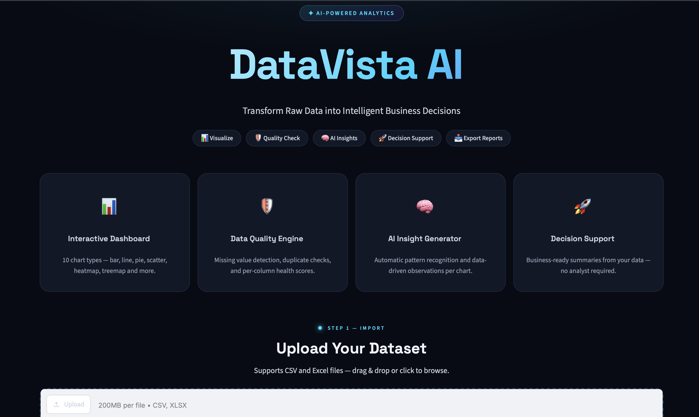
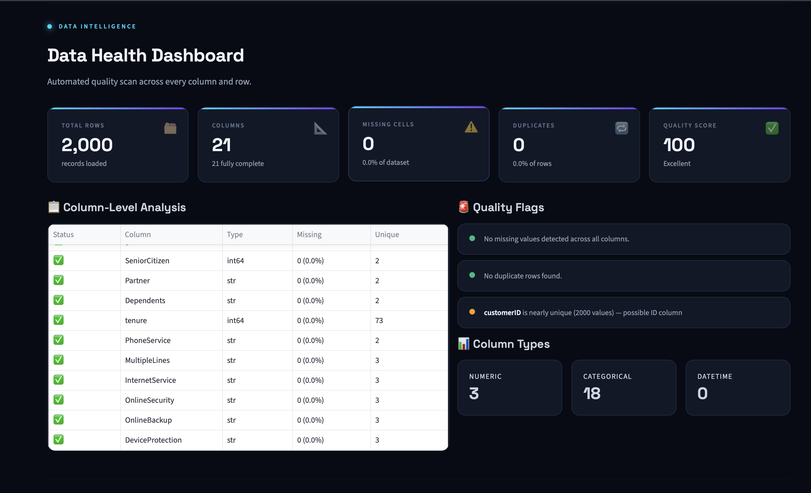
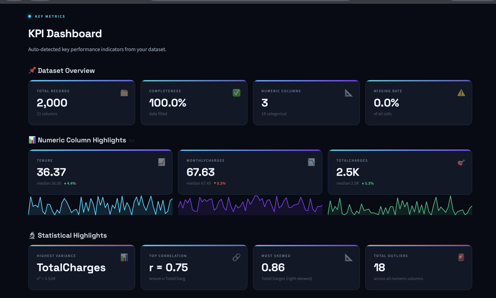
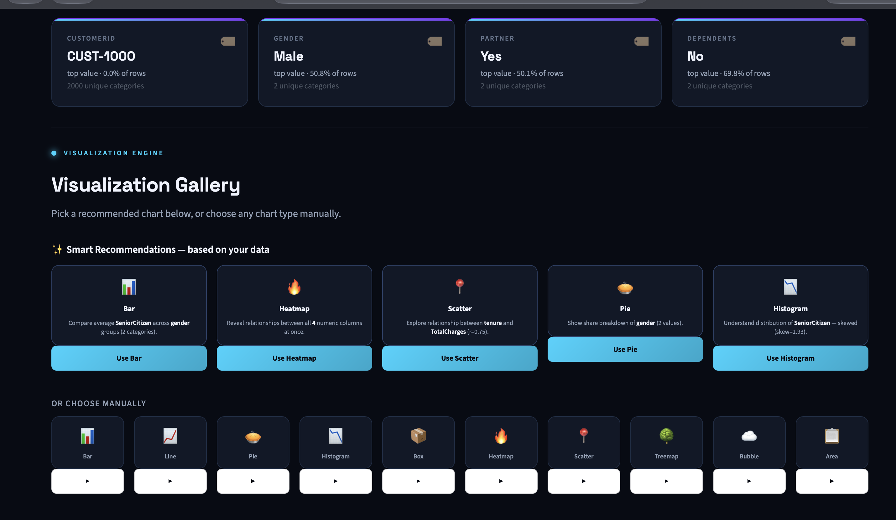
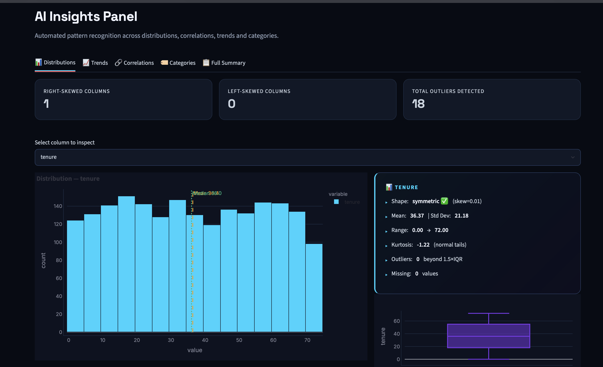
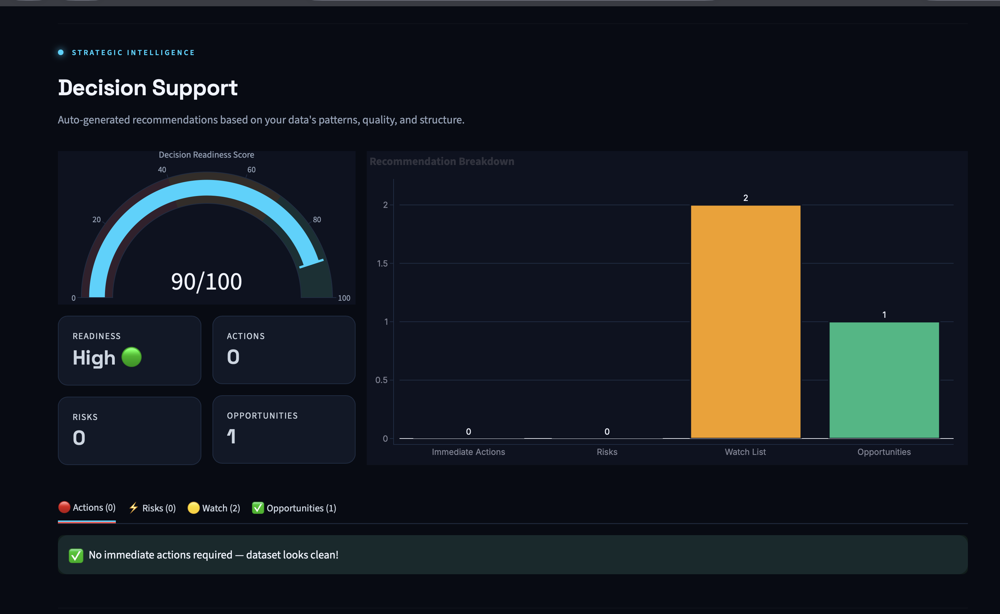
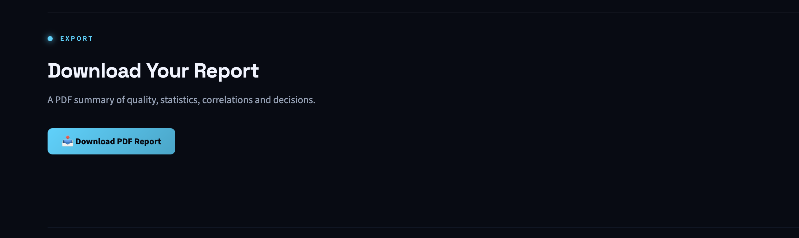

# DataVista AI 📊

**Upload any CSV or Excel file and get an automated data quality check, KPIs, chart recommendations, insights, decision support, and a downloadable PDF report.**

## Why I built this
Analysts spend a lot of time on the first pass of every dataset: checking quality, picking charts and summarizing patterns. DataVista AI automates that first pass. It also warns users when their data is too messy to chart reliably, so they don't draw wrong conclusions from misleading charts.

## Features
- 🛡️ **Data health dashboard:** missing values, duplicates, column types and a quality score
- 🚦 **Quality gate:** warns or blocks before charting when data is likely to mislead
- 📌 **KPI dashboard:** key metrics, correlations, skew and outliers detected automatically
- 📊 **Chart recommendations:** ranks the best chart types for your columns, with 10 interactive Plotly charts
- 🧠 **Automated insights (rule-based):** distribution, trend, correlation and category analysis
- 🚀 **Decision support:** actions, risks, watch list, opportunities and a readiness score
- 📥 **PDF report export** with all sections

## Screenshots
| Home | Data Health |
|---|---|
|  |  |
| **KPI Dashboard** | **Charts and Insights** |
|  |  |
| **Insights Panel** | **Decision Support** |
|  |  |

**Sample PDF report:** [Screenshots/sample-report.pdf](Screenshots/sample-report.pdf)



## How it works
Upload → Parse → Preview → Quality scan → KPIs → Quality gate → Chart recommendation → Chart rendering → Insights → Decision engine → PDF report

### How the scores work
- **Quality score:** starts at 100. It subtracts 2 points per 1% of missing cells (capped at 40) and 2 points per 1% of duplicate rows (capped at 20). 80 or more is Excellent, 50 to 79 is Fair, below 50 is Poor.
- **Quality gate:** checks for duplicate rows, columns more than 20% empty, inconsistent spelling or case in text columns (like "Sales" and "sales "), and extreme outliers (beyond 3×IQR). No issues means clean. Any issue shows a warning the user must accept. A score under 50, more than 30% duplicates or more than 40% missing blocks the charts until the data is cleaned.
- **Column types:** numeric columns with only two unique values (like 0/1 flags) are treated as categorical, so skew and outlier statistics are not computed for them.
- **Chart ranking:** rule-based scores per chart type from the column types available (for example Bar 90, Heatmap 88 when there are 3 or more numeric columns, Scatter 85). The top 5 are shown.
- **Readiness score:** starts at 100, minus 15 per immediate action, 10 per risk and 5 per watch-list item (minimum 10). 70 or more is High, 40 to 69 is Medium.
- **Scatter insight:** reports Pearson correlation and also Spearman rank correlation, which is less affected by outliers. If the two differ a lot, it warns that outliers may be hiding a real relationship.

## Tech stack
Python · Streamlit · Pandas · NumPy · Plotly · ReportLab · OpenPyXL

## Project structure
```
DataVista-AI/
├── app.py                  # Streamlit entry point and quality gate
├── components/
│   ├── upload.py           # CSV/Excel reading
│   ├── utils.py            # column type detection and quality gate checks
│   ├── data_quality.py     # health dashboard
│   ├── kpi.py              # KPI dashboard
│   ├── charts.py           # recommendations and 10 chart types
│   ├── insights.py         # insights panel
│   ├── decision.py         # decision engine and readiness score
│   └── report.py           # PDF export
├── assets/style.css
├── Screenshots/
└── requirements.txt
```

## Run locally
```bash
git clone https://github.com/DeepikaSai10/DataVista-AI.git
cd DataVista-AI
pip install -r requirements.txt
streamlit run app.py
```

## Testing done
Tried on the Telco customer churn dataset (2,000 rows, 21 columns) and on a deliberately messy synthetic dataset with duplicates, missing values, outliers and inconsistent text, to check the quality gate and chart handling.

## Limitations and future work
- Insights are rule-based, not machine-learning or LLM-generated. An LLM summary layer is a planned improvement.
- The app flags messy data but does not clean it yet. A built-in cleaning step is planned.
- No automated tests yet, and not tested on very large files.

## Author
**Kalla Deepika Sai** · [LinkedIn](https://www.linkedin.com/in/deepikasaikalla)
